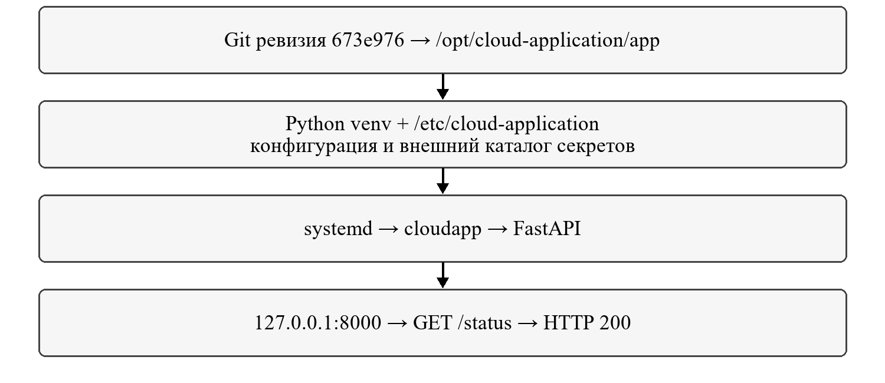
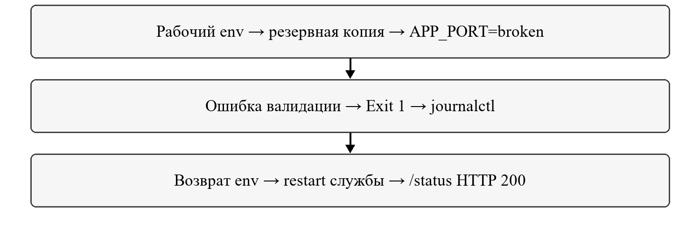

# Лабораторная работа 36

## Развертывание серверного приложения

Автор: Дьяченко Артем
Дата выполнения: 21 ноября 2026 года

Дисциплина: Управление работами и разработка программного обеспечения облачных систем. Результат обучения: РО 3.2 Эксплуатировать облачные системы.

## Цель работы

Развернуть Cloud Application в Linux без контейнеризации приложения, отделить конфигурацию и секреты, настроить службу systemd и проверить восстановление после ошибки конфигурации.

## Паспорт целевой среды

Использована отдельная локальная Ubuntu WSL 2 CloudLabs. Приложение запускается непосредственно в Linux через Python venv и systemd. Docker для запуска приложения в этой работе не применяется.

| Параметр | Фактическое значение |
| --- | --- |
| Hostname и ОС | cloudlabs, Ubuntu 24.04.5 LTS |
| Ядро | 6.18.33.2-microsoft-standard-WSL2 |
| Менеджер служб | systemd, PID 1 |
| Python и Git | Python 3.12.3; git version 2.43.0 |
| Пользователь | cloudapp, UID 997, GID 997, /usr/sbin/nologin |
| Код | /opt/cloud-application/app |
| Окружение | /opt/cloud-application/venv |
| Конфигурация | /etc/cloud-application/cloud-application.env |
| Секреты | /etc/cloud-application/secrets |
| Служба | cloud-application.service |
| Привязка и порт | 127.0.0.1:8000 |
| Журнал | systemd journal |
| Git commit | 673e97690b557a5b2e8131d7677407e24108cdf8 |
| Внешний доступ | Не настраивается для systemd-приложения |



Рисунок 1 Схема серверного развёртывания

## Подготовка сервера и исходной версии

Установлены Git, Python 3, python3-venv, pip и curl. Созданы системный пользователь cloudapp и каталоги приложения. Код клонирован из GitHub и переведён на конкретную ревизию в detached HEAD.

```text
sudo sh deploy/lr36-install.sh 673e97690b557a5b2e8131d7677407e24108cdf8
673e976 Add reproducible server and container deployments and configurable network bind
uid=997(cloudapp) gid=997(cloudapp) groups=997(cloudapp)
```

После подключения ссылки secrets каталог исключён локальным правилом Git. Итоговый git status --short пуст. В основном проекте правило .gitignore также дополнено для ссылки с этим именем.

## Python окружение и зависимости

```text
sudo -u cloudapp python3 -m venv /opt/cloud-application/venv
sudo -u cloudapp /opt/cloud-application/venv/bin/python -m pip install -r /opt/cloud-application/app/requirements.txt
/opt/cloud-application/venv/bin/python -m pip check
No broken requirements found.
/opt/cloud-application/venv/bin/python -c "import fastapi, uvicorn, sqlalchemy, httpx; print('IMPORTS_OK')"
IMPORTS_OK
```

Зависимости установлены из зафиксированного requirements.txt в venv. Глобальные Python-пакеты сервера для приложения не используются.

## Эксплуатационная конфигурация и секреты

```text
APP_NAME=CloudApplication
APP_VERSION=0.8
APP_ENV=production
APP_HOST=127.0.0.1
APP_PORT=8000
DEBUG=false
HTTPS_ENABLED=false
DB_HOST=127.0.0.1
DB_PORT=5432
DB_NAME=cloud_application
DB_USER=postgres
NOTIFICATION_SERVICE_URL=http://127.0.0.1:9000
NOTIFICATION_TIMEOUT_SECONDS=2.0
NOTIFICATION_MAX_ATTEMPTS=3
NOTIFICATION_RETRY_DELAY_SECONDS=0.5
LOG_LEVEL=INFO
```

| Объект | Владелец и права |
| --- | --- |
| /etc/cloud-application | root:cloudapp, 0750 |
| cloud-application.env | root:cloudapp, 0640 |
| /etc/cloud-application/secrets | root:cloudapp, 0750 |
| auth_secret и lab_db_password | root:cloudapp, 0640 |
| app/secrets | Ссылка → /etc/cloud-application/secrets |
| app/storage/objects | cloudapp:cloudapp, 0750 |

```text
AUTH_SECRET_READABLE
DB_SECRET_READABLE
```

Оба значения созданы случайным генератором на сервере. Проверено чтение от имени cloudapp без вывода содержимого. PostgreSQL и Notification Service в ЛР 36 не запускаются; /status не требует их доступности.

## Служба systemd

```text
[Unit]
Description=Cloud Application FastAPI Service
After=network.target

[Service]
Type=simple
User=cloudapp
Group=cloudapp
WorkingDirectory=/opt/cloud-application/app
EnvironmentFile=/etc/cloud-application/cloud-application.env
ExecStart=/opt/cloud-application/venv/bin/python /opt/cloud-application/app/run.py
Restart=on-failure
RestartSec=3
TimeoutStopSec=15
UMask=0027
NoNewPrivileges=true
StandardOutput=journal
StandardError=journal

[Install]
WantedBy=multi-user.target
```

```text
systemd-analyze verify /etc/systemd/system/cloud-application.service
# Проверка завершилась с кодом 0
systemctl daemon-reload
systemctl enable --now cloud-application.service
# Создана ссылка в multi-user.target.wants
```

EnvironmentFile передаёт обычную конфигурацию, WorkingDirectory задаёт рабочую папку. Служба выполняется от cloudapp; Restart=on-failure обеспечивает повторный запуск после сбоя, NoNewPrivileges запрещает получение новых привилегий.

## Результаты успешного запуска

```text
MainPID=85
ExecMainStatus=0
User=cloudapp
Group=cloudapp
ActiveState=active
SubState=running
UnitFileState=enabled
PID USER     GROUP    COMMAND
     85 cloudapp cloudapp /opt/cloud-application/venv/bin/python /opt/cloud-application/app/run.py
State  Recv-Q Send-Q Local Address:Port Peer Address:PortProcess
LISTEN 0      2048       127.0.0.1:8000      0.0.0.0:*    users:(("python",pid=85,fd=6))
```

```text
Nov 21 15:31:12 cloudlabs python[85]: INFO:     Finished server process [85]
Nov 21 15:31:12 cloudlabs systemd[1]: cloud-application.service: Deactivated successfully.
Nov 21 15:31:12 cloudlabs systemd[1]: Stopped cloud-application.service - Cloud Application FastAPI Service.
Nov 21 15:31:12 cloudlabs systemd[1]: cloud-application.service: Consumed 1.384s CPU time.
Nov 21 15:31:33 cloudlabs systemd[1]: Started cloud-application.service - Cloud Application FastAPI Service.
Nov 21 15:31:34 cloudlabs python[85]: INFO:     Started server process [85]
Nov 21 15:31:34 cloudlabs python[85]: INFO:     Waiting for application startup.
Nov 21 15:31:34 cloudlabs python[85]: INFO:     Application startup complete.
Nov 21 15:31:34 cloudlabs python[85]: INFO:     Uvicorn running on http://127.0.0.1:8000 (Press CTRL+C to quit)
```

```text
GET http://127.0.0.1:8000/status → HTTP 200
{"status":"ok","service":"CloudApplication","environment":"production","host":"127.0.0.1","port":8000,"api_prefix":"/api"}
GET /docs → HTTP 200
```

| Проверка | Результат |
| --- | --- |
| Python зависимости | pip check и IMPORTS_OK успешно |
| Unit verify | Код завершения 0 |
| Автозапуск | enabled |
| Состояние | active / running |
| Процесс | MainPID 85, cloudapp:cloudapp |
| Порт | Только 127.0.0.1:8000 |
| /status и /docs | HTTP 200 |
| Конфигурация и секреты | В /etc, чтение разрешено cloudapp |

## Контролируемый отказ и rollback



Рисунок 2 Диагностика и rollback конфигурации

Перед изменением создана копия env-файла с сохранением прав. APP_PORT заменён на broken, затем выполнен restart. Процесс завершился с кодом 1. Из-за Restart=on-failure unit перешёл в activating / auto-restart. Журнал однозначно указывает на неверный тип порта.

```text
Result=exit-code
ExecMainStatus=1
ActiveState=activating
SubState=auto-restart
Nov 21 15:20:18 cloudlabs python[651]: pydantic_core._pydantic_core.ValidationError: 1 validation error for Settings
Nov 21 15:20:18 cloudlabs python[651]: app_port
Nov 21 15:20:18 cloudlabs python[651]:   Input should be a valid integer, unable to parse string as an integer [type=int_parsing, input_value='broken', input_type=str]
```

Служба остановлена, исходный env возвращён из копии, совпадение подтверждено cmp. После reset-failed и start получен успешный /status. Дополнительный restart изменил PID процесса.

```text
ENV_BACKUP_RESTORED
PID_BEFORE=661
PID_AFTER=671
/status после rollback → HTTP 200
```

## Самостоятельная эксплуатационная проверка

После перезапуска только дистрибутива CloudLabs служба автоматически вернулась в active. Автозапуск подтверждён на новой загрузке Linux-среды; Windows не перезагружалась.

```text
=== After WSL distribution restart ===
systemd
enabled
active
MainPID=85
User=cloudapp
{"status":"ok","service":"CloudApplication","environment":"production","host":"127.0.0.1","port":8000,"api_prefix":"/api"}
active
```

Итоговый паспорт работающей службы приведён выше: конфигурация и секреты находятся в /etc, журнал читается через journalctl, пользователь процесса cloudapp. Среда сохранена для следующих работ. Общий systemd имеет отдельный failed unit kmod-static-nodes из минимального WSL-образа; служба приложения и Docker работают, к отказу приложения этот unit не относится.

## Ответы на контрольные вопросы

1. Что называется развертыванием серверного приложения?
Подготовка среды, установка определённой версии приложения, настройка запуска и проверка работоспособности.

2. Чем deployment отличается от разработки?
Разработка меняет программу, deployment размещает готовую версию в целевой среде.

3. Что называется целевой средой?
ОС, ресурсы, каталоги, пользователи, зависимости и сетевые параметры места запуска.

4. Для чего составляется паспорт целевой среды?
Он фиксирует параметры установки и позволяет повторить диагностику и восстановление.

5. Почему необходимо фиксировать commit hash?
Хеш однозначно связывает работающий код с исходной ревизией.

6. Почему на сервер должна попадать определённая версия проекта?
Это обеспечивает воспроизводимость и позволяет сравнивать версии при отказе.

7. Почему приложение не запускается от root?
Непривилегированный процесс ограничивает последствия ошибки или уязвимости.

8. Для чего создан пользователь cloudapp?
Он владеет рабочими файлами и выполняет процесс приложения отдельно от администратора.

9. Почему его shell установлен в nologin?
nologin запрещает обычный интерактивный вход под служебной учётной записью.

10. Для чего используется каталог /opt/cloud-application?
Для размещения кода и отдельного Python-окружения приложения.

11. Почему конфигурация помещена в /etc/cloud-application?
В /etc размещается конфигурация машины, которая имеет собственные права и жизненный цикл.

12. Для чего используется Python virtual environment?
Оно изолирует Python-пакеты приложения от системного Python и других проектов.

13. Почему не следует устанавливать зависимости приложения глобально?
Глобальная установка создаёт конфликты между приложениями и системными пакетами.

14. Что проверяет pip check?
Наличие требуемых пакетов и совместимость объявленных зависимостей установленных дистрибутивов.

15. Чем runtime-зависимости отличаются от dev-зависимостей?
Runtime-пакеты нужны для работы приложения, dev-пакеты — для разработки, тестирования и анализа.

16. Почему секреты не должны храниться в Git?
История Git и копии репозитория могут раскрыть секрет всем, кто имеет доступ к коду.

17. Почему каталог секретов размещён отдельно от исходного кода?
Это позволяет обновлять код без переноса секретов и назначать отдельные права доступа.

18. Для чего используется символическая ссылка secrets?
Она подключает внешний каталог к пути secrets, который ожидает приложение.

19. Как проверяется доступность секретов без вывода значения?
Командой test -r от имени пользователя приложения без чтения содержимого в терминал.

20. Для чего используется EnvironmentFile?
Для передачи переменных из отдельного файла в окружение процесса службы.

21. Что делает WorkingDirectory в systemd unit?
Задаёт текущий каталог процесса и основу для относительных путей.

22. Что запускает ExecStart?
Интерпретатор из venv с файлом run.py развёрнутого приложения.

23. Почему unit выполняется от cloudapp?
Чтобы приложение не получало права root и работало под отдельной служебной учётной записью.

24. Для чего используется Restart=on-failure?
systemd повторно запускает процесс после аварийного завершения.

25. Что делает RestartSec?
Устанавливает задержку между аварией и следующей попыткой запуска.

26. Для чего используется NoNewPrivileges=true?
Запрещает процессу и его потомкам получать дополнительные привилегии через exec.

27. Что делает enable --now?
Включает автозапуск unit и сразу запускает его.

28. Чем enabled отличается от active?
enabled означает включённый автозапуск, active — текущее активное состояние.

29. Как получить MainPID?
systemctl show cloud-application.service -p MainPID --value.

30. Как проверить пользователя процесса?
ps -p PID -o pid,user,group,args.

31. Для чего используется journalctl -u?
Для чтения журналов выбранной службы и поиска причины ошибок.

32. Что называется smoke-test?
Короткая проверка основных признаков работоспособности после установки или изменения.

33. Почему /status подходит для базовой smoke-проверки?
Он возвращает диагностический ответ без обращения к PostgreSQL и Notification Service.

34. Почему Swagger UI проверяется отдельно?
Чтобы проверить выдачу документации и доступность веб-интерфейса API.

35. Как проверить слушаемый TCP-порт?
ss -ltnp с фильтром порта 8000.

36. Почему приложение привязано к 127.0.0.1?
ЛР 36 проверяет локальный запуск; сетевой доступ с других машин пока не нужен.

37. Почему в ЛР №36 не используется 0.0.0.0?
0.0.0.0 открыл бы прослушивание на всех IPv4-интерфейсах до сетевого этапа.

38. Почему не все REST API должны работать без PostgreSQL?
Операции пользователей, сервисов и сессий требуют действующей БД.

39. Когда будет развернута полная многокомпонентная система?
В ЛР 38, которая является подготовкой к сетевому этапу ЛР 39.

40. Что называется rollback?
Возврат к ранее проверенной конфигурации или версии после неудачного изменения.

41. Почему перед экспериментом создаётся резервная копия конфигурации?
Чтобы вернуть точное рабочее содержимое и права файла без ручного восстановления.

42. Как журнал помогает определить причину неуспешного deployment?
Он содержит исключение, имя неверного поля и статус завершения процесса.

43. Нужно ли выполнять daemon-reload после изменения только EnvironmentFile?
Нет. Файл заново читается при перезапуске службы; daemon-reload нужен при изменении unit.

44. Почему после rollback необходимо повторить smoke-test?
Активный процесс ещё не доказывает, что приложение отвечает корректно.

45. Чем ЛР №36 отличается от ЛР №37?
В ЛР 36 код запускается в venv через systemd; в ЛР 37 используется Docker image.

46. Чем ЛР №36 отличается от ЛР №39?
В ЛР 36 проверяется локальный сервер, в ЛР 39 настраивается доступ с Windows по сетевому IP.

47. Почему развернутую среду следует сохранить для следующих лабораторных работ?
Она нужна для сравнения deployment-моделей и последующих эксплуатационных проверок.

## Вывод

Cloud Application развернут в отдельной Linux-среде как systemd-служба с Python venv, непривилегированным пользователем, внешней конфигурацией и секретами. Подтверждены локальный HTTP-доступ, автозапуск, смена PID после restart и восстановление после неверного APP_PORT. Рабочая установка сохранена.
