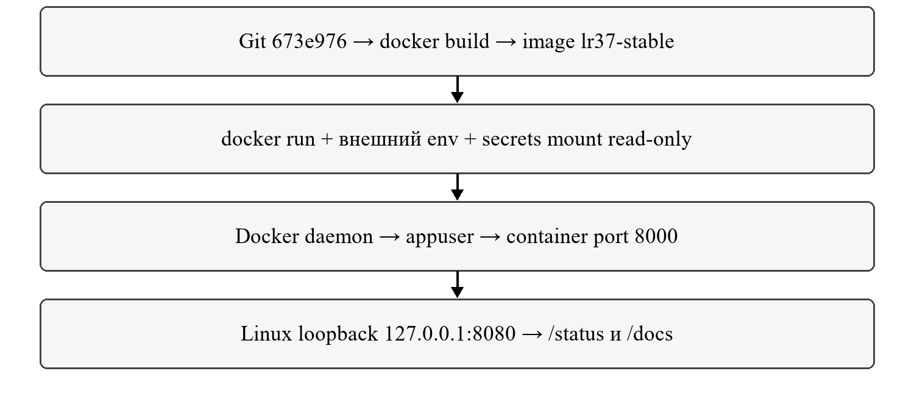
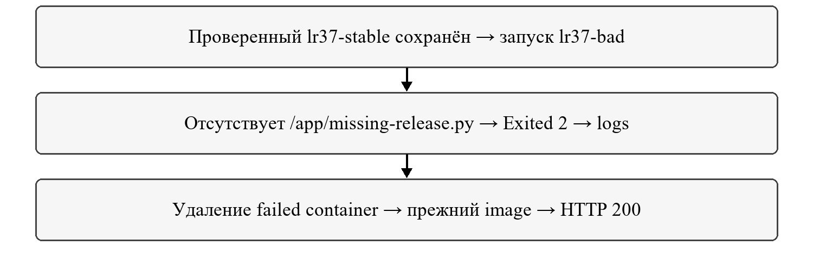

# Лабораторная работа 37

## Развертывание контейнеризированного приложения

Автор: Дьяченко Артем
Дата выполнения: 21 ноября 2026 года

Дисциплина: Управление работами и разработка программного обеспечения облачных систем. Результат обучения: РО 3.2 Эксплуатировать облачные системы.

## Цель работы

Развернуть один контейнер Cloud Application из зафиксированной Git-версии, отделить runtime-конфигурацию и секреты, проверить жизненный цикл и rollback на стабильный image.

## Среда и идентификация версии

Использован собственный Docker Engine внутри Ubuntu WSL 2 CloudLabs. Docker Desktop Windows является отдельной средой и для выполнения этой работы не используется. Применена текущая версия приложения 0.8; учебные теги lr37-stable и lr37-bad отделяют проверенные артефакты от других локальных образов.

| Параметр | Фактическое значение |
| --- | --- |
| ОС и hostname | Ubuntu 24.04.5 LTS, cloudlabs |
| Docker Engine | 29.1.3 |
| Docker daemon | active, systemd unit docker.service |
| Git commit | 673e97690b557a5b2e8131d7677407e24108cdf8 |
| Image tag | cloud-application:lr37-stable |
| Image ID | sha256:0bbe96f0f5cb48e2e63a787d58e7014cc18da7e065fdd3e0c570dd707dd7a0dd |
| OCI revision | 673e97690b557a5b2e8131d7677407e24108cdf8 |
| Пользователь image | appuser, UID 1000, GID 1000 |
| Python в image | 3.14.10 |
| Рабочий каталог | /app |



Рисунок 1 Схема контейнерного развёртывания

## Dockerfile и сборка

```text
FROM python:3.14-slim@sha256:cd89c30eda26ee911a4611b18680086e0ea42e6f5f8cbe653d07fa7958c9cec8

ENV PYTHONDONTWRITEBYTECODE=1 \
    PYTHONUNBUFFERED=1 \
    APP_HOST=0.0.0.0 \
    APP_PORT=8000 \
    HTTPS_ENABLED=false

WORKDIR /app

COPY requirements.txt ./
RUN python -m pip install --no-cache-dir -r requirements.txt

RUN useradd --create-home --shell /usr/sbin/nologin appuser \
    && mkdir -p /app/storage && chown appuser:appuser /app/storage

COPY --chown=appuser:appuser app ./app
COPY --chown=appuser:appuser migrations ./migrations
COPY --chown=appuser:appuser alembic.ini ./
COPY --chown=appuser:appuser run.py ./

USER appuser
EXPOSE 8000

ARG GIT_REVISION=unknown
LABEL org.opencontainers.image.revision="${GIT_REVISION}" \
      org.opencontainers.image.title="Cloud Application" \
      org.opencontainers.image.version="0.8"

CMD ["python", "run.py"]
```

```text
cd /opt/cloud-application/app
docker build --build-arg GIT_REVISION=673e97690b557a5b2e8131d7677407e24108cdf8 -t cloud-application:lr37-stable .
Successfully built 0bbe96f0f5cb
Successfully tagged cloud-application:lr37-stable
```

Метка org.opencontainers.image.revision совпала с commit исходной версии. Значение Image ID контейнера совпало с ID стабильного image. Секреты и env-файл не входят в контекст благодаря .dockerignore и не копируются Dockerfile.

## Runtime конфигурация и секреты

Обычная конфигурация передаётся из /etc/cloud-application/cloud-application.env, созданного в ЛР 36. Внутри контейнера APP_HOST переопределён в 0.0.0.0, APP_PORT в 8000, HTTPS выключен. Зависимые сервисы для одиночного deployment не запускаются.

```text
docker run --rm --entrypoint id cloud-application:lr37-stable -u appuser
1000
docker run --rm --entrypoint id cloud-application:lr37-stable -g appuser
1000
```

| Объект | Владелец и режим |
| --- | --- |
| /etc/cloud-application-container/secrets | 1000:1000, 0750 |
| auth_secret | 1000:1000, 0640 |
| lab_db_password | 1000:1000, 0640 |
| Контейнерный путь | /app/secrets, bind mount, RW=false |

Секреты скопированы из внешнего каталога ЛР 36 с назначением фактических UID/GID контейнера. Доступ проверен test -r от appuser; значения в журнал и отчёт не выводятся.

## Запуск стабильного контейнера

```text
docker run -d --name cloud-application-lr37 \
  --restart unless-stopped \
  -p 127.0.0.1:8080:8000 \
  --env-file /etc/cloud-application/cloud-application.env \
  -e APP_HOST=0.0.0.0 -e APP_PORT=8000 -e HTTPS_ENABLED=false \
  --mount type=bind,src=/etc/cloud-application-container/secrets,dst=/app/secrets,readonly \
  cloud-application:lr37-stable
```

```text
State=running
Restart=unless-stopped
8000/tcp -> 127.0.0.1:8080
whoami → appuser
pwd → /app
Python 3.14.10
AUTH_SECRET_READABLE
DB_SECRET_READABLE
Mount: /etc/cloud-application-container/secrets → /app/secrets
Type=bind, RW=false
```

docker ps показал работающий контейнер, docker port подтвердил loopback-публикацию. Через docker inspect проверены image, restart policy, PID и mount. Просмотр docker logs -f прерван по таймауту; контейнер продолжил работу.

```text
INFO: Started server process [1]
INFO: Application startup complete.
INFO: Uvicorn running on http://0.0.0.0:8000
GET /status → HTTP 200
{"status":"ok","service":"CloudApplication","environment":"production","host":"0.0.0.0","port":8000,"api_prefix":"/api"}
GET /docs → HTTP 200
```

| Критерий | Результат |
| --- | --- |
| Daemon | active |
| Контейнер | running |
| Image и revision | Совпадают с таблицей идентификации |
| Restart | unless-stopped |
| User | appuser |
| Mount секретов | read-only |
| Host bind | 127.0.0.1:8080 |
| /status | HTTP 200, status=ok |
| /docs | HTTP 200 |
| Logs | Успешное завершение startup |

## Жизненный цикл контейнера

docker stop перевёл контейнер в Exited, docker ps -a сохранил его запись. docker start вернул контейнер в running. После docker restart создан новый основной Linux-процесс, затем /status снова вернул HTTP 200.

```text
PID_BEFORE=1298
PID_AFTER=1425
```

## Неуспешный release и rollback



Рисунок 2 Эксплуатация и rollback image

```text
FROM cloud-application:lr37-stable
CMD ["python", "/app/missing-release.py"]
```

Из этого Dockerfile собран cloud-application:lr37-bad. Предыдущий контейнер остановлен и удалён, плохая версия запущена без restart policy для однозначной диагностики. Она завершилась с кодом 2.

```text
CMD ["python", "/app/missing-release.py"]
Step 2/2 : CMD ["python", "/app/missing-release.py"]
21b3d1927990   cloud-application:lr37-bad   "python /app/missing…"   2 seconds ago   Exited (2) 2 seconds ago             cloud-application-lr37
Tag=cloud-application:lr37-bad State=exited ExitCode=2
python: can't open file '/app/missing-release.py': [Errno 2] No such file or directory
```

Причина: команда запуска ссылается на отсутствующий /app/missing-release.py. После сохранения состояния и журнала неработающий контейнер удалён, повторена полная стабильная команда запуска. Проверен прежний Image ID, unless-stopped и read-only mount, /status и /docs вернули HTTP 200. Учебный bad image удалён после диагностики.

```text
Tag=cloud-application:lr37-stable
Image=sha256:0bbe96f0f5cb48e2e63a787d58e7014cc18da7e065fdd3e0c570dd707dd7a0dd
Restart=unless-stopped
State=running
Mount RW=false
/status → HTTP 200
/docs → HTTP 200
```

## Сравнение моделей развёртывания

| Признак | ЛР 36 systemd и venv | ЛР 37 Docker |
| --- | --- | --- |
| Изоляция пакетов | Python venv | Файловая система image |
| Артефакт | Git checkout и requirements | Image с ID и revision |
| Управление | systemd | Docker daemon |
| Код | /opt/cloud-application/app | /app внутри image |
| Конфигурация | EnvironmentFile | --env-file и -e |
| Секреты | Внешний /etc + symlink | Внешний /etc + RO mount |
| Автозапуск | enable и on-failure | unless-stopped |
| Журнал | journalctl -u | docker logs |
| Состояние | systemctl show/status | docker inspect/ps |
| Rollback | Возврат env + restart | Возврат image + новый container |

Image делает перенос runtime-кода и Python-зависимостей воспроизводимым: при повторном запуске используется один и тот же собранный артефакт.

## Итоговый паспорт и самостоятельная проверка

| Параметр | Сохранённое состояние |
| --- | --- |
| Hostname | cloudlabs |
| Docker | 29.1.3, active |
| Container | cloud-application-lr37 |
| Image | sha256:0bbe96f0f5cb48e2e63a787d58e7014cc18da7e065fdd3e0c570dd707dd7a0dd |
| Статус и PID | running, PID 480 |
| Пользователь | appuser |
| Restart policy | unless-stopped |
| Итоговая публикация | 127.0.0.1:8081 → 8000 |
| Secrets mount | /etc/cloud-application-container/secrets → /app/secrets, RO |
| /status и /docs | HTTP 200 |
| Последний rollback | lr37-bad → lr37-stable, успешно |

После проверки ЛР 37 отдельный контейнер пересоздан с loopback-портом 8081, чтобы одновременно оставить Compose-систему ЛР 39 на 8080. Проверки и rollback выше выполнены на 8080. После systemctl restart docker, а затем после перезапуска дистрибутива CloudLabs контейнер автоматически вернулся в running. Стабильный образ, каталог секретов и systemd-установка ЛР 36 сохранены.

## Ответы на контрольные вопросы

1. Что называется контейнерным image?
Неизменяемый набор слоёв файловой системы и метаданных для создания контейнеров.

2. Что называется container?
Созданный из image экземпляр с процессами, параметрами запуска и записываемым слоем.

3. Чем image отличается от container?
Image является шаблоном, container — его отдельным экземпляром с собственным жизненным циклом.

4. Что является deployment artifact в ЛР №37?
Контейнерный image с тегом, Image ID и меткой исходной Git-ревизии.

5. Почему image связывается с Git commit?
Чтобы определить исходный код работающей версии и повторить сборку.

6. Для чего используется tag?
Для удобного именования версии. Тег можно переназначить, поэтому дополнительно фиксируется Image ID.

7. Что показывает Image ID?
Контентный идентификатор конфигурации образа, позволяющий отличить фактически собранный артефакт.

8. Для чего добавлена OCI-метка org.opencontainers.image.revision?
Для хранения полного Git commit в метаданных image.

9. Почему эксплуатационная конфигурация не включается в image?
Один image должен запускаться в разных средах с разными эксплуатационными настройками.

10. Почему секреты не включаются в Dockerfile?
Секреты могут остаться в слоях и истории сборки и попасть всем получателям image.

11. Для чего используется --env-file?
Передаёт переменные из внешнего файла при создании контейнера.

12. Почему APP_HOST внутри контейнера должен быть 0.0.0.0?
Чтобы процесс принимал обращения через контейнерный интерфейс, а не только свой loopback.

13. Почему host port привязан к 127.0.0.1?
Чтобы приложение было доступно только на локальном интерфейсе Linux-хоста.

14. Что означает 127.0.0.1:8080:8000?
TCP 8080 на loopback хоста перенаправляется на TCP 8000 контейнера.

15. Почему внешний сетевой доступ не рассматривается в ЛР №37?
Ему посвящена ЛР 39; здесь проверяется контейнерный deployment.

16. Для чего используется bind mount?
Для подключения внешних файлов сервера к файловой системе контейнера.

17. Почему секреты подключаются read-only?
Процесс должен читать секреты, но не менять их исходные файлы.

18. Почему необходимо учитывать UID/GID пользователя контейнера?
Права Linux проверяются по числовым идентификаторам владельца и группы.

19. Как определить UID appuser без запуска основного приложения?
docker run --rm --entrypoint id IMAGE -u appuser; аналогично -g для GID.

20. Для чего используется docker inspect?
Для чтения состояния, image, PID, mount, restart policy и сетевых параметров.

21. Что показывает docker ps?
Список работающих контейнеров.

22. Чем docker ps -a отличается от docker ps?
Опция -a добавляет остановленные и завершившиеся контейнеры.

23. Для чего используется docker logs?
Для чтения stdout и stderr процесса контейнера.

24. Что делает docker logs -f?
Показывает новые строки журнала по мере их поступления.

25. Останавливает ли Ctrl+C контейнер при просмотре логов?
Нет, прерывается только клиент просмотра журнала.

26. Для чего используется docker exec?
Запускает дополнительную команду в работающем контейнере.

27. Как проверить пользователя внутри контейнера?
docker exec CONTAINER whoami или id.

28. Для чего используется restart policy?
Определяет автоматическое восстановление контейнера при сбое и запуске Docker.

29. Чем unless-stopped отличается от отсутствия restart policy?
unless-stopped восстанавливает контейнер, пока он не остановлен пользователем; без политики автоматического восстановления нет.

30. Почему контейнер не оформляется отдельной systemd-службой?
Контейнером управляет Docker daemon; отдельный unit для того же контейнера создаёт двух управляющих.

31. Что делает docker stop?
Посылает сигнал завершения и после таймаута принудительно останавливает процесс.

32. Что делает docker start?
Запускает существующий остановленный контейнер с прежней конфигурацией.

33. Что делает docker restart?
Останавливает и запускает тот же контейнер.

34. Почему PID после restart может измениться?
При старте создаётся новый процесс, которому Linux назначает новый PID.

35. Что называется smoke-test?
Короткая проверка основных HTTP-маршрутов после запуска.

36. Почему после rollback необходимо повторить /status?
Чтобы подтвердить результат восстановления, а не только наличие процесса.

37. Почему неработающий контейнер нельзя сразу удалять без диагностики?
Удаление уничтожает доступное состояние и журнал, необходимые для определения причины.

38. Что необходимо зафиксировать перед удалением failed-контейнера?
Тег и ID image, состояние, ExitCode и диагностический журнал.

39. Что означает rollback по image tag?
Создание нового контейнера из ранее проверенного image. Для строгой идентификации дополнительно сверяется ID.

40. Почему stable image не удаляется при тестировании новой версии?
Иначе исчезнет доступный артефакт для быстрого восстановления.

41. Чем rollback ЛР №37 отличается от rollback конфигурации ЛР №36?
В ЛР 37 возвращается image и пересоздаётся контейнер; в ЛР 36 возвращается env-файл и перезапускается служба.

42. Почему в ЛР №37 не используется полный compose.yaml?
Проверяется один компонент без развёртывания PostgreSQL и Notification Service.

43. Какие компоненты будут добавлены в ЛР №38?
PostgreSQL, Notification Service, миграции, внутренняя сеть и постоянные volumes.

44. В чём эксплуатационное преимущество неизменяемого image?
Одинаковая файловая система и набор зависимостей переносятся между средами без повторной установки на сервер.

45. Чем ЛР №37 отличается от разработческой ЛР №27?
ЛР 27 знакомит со сборкой image, ЛР 37 включает эксплуатационные параметры, диагностику, жизненный цикл и rollback.

## Вывод

Контейнерный deployment выполнен из зафиксированной Git-ревизии. Подтверждены непривилегированный пользователь, внешняя конфигурация, защищённый read-only mount, локальная публикация, restart policy и жизненный цикл. Ошибка запуска плохой версии диагностирована, rollback вернул тот же стабильный Image ID и работоспособный HTTP-сервис.
