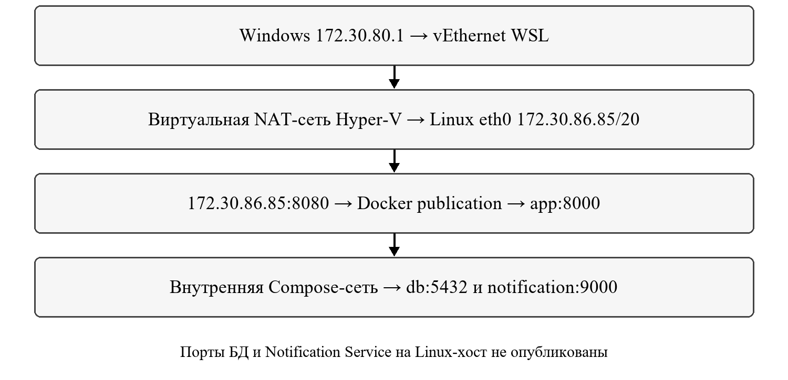
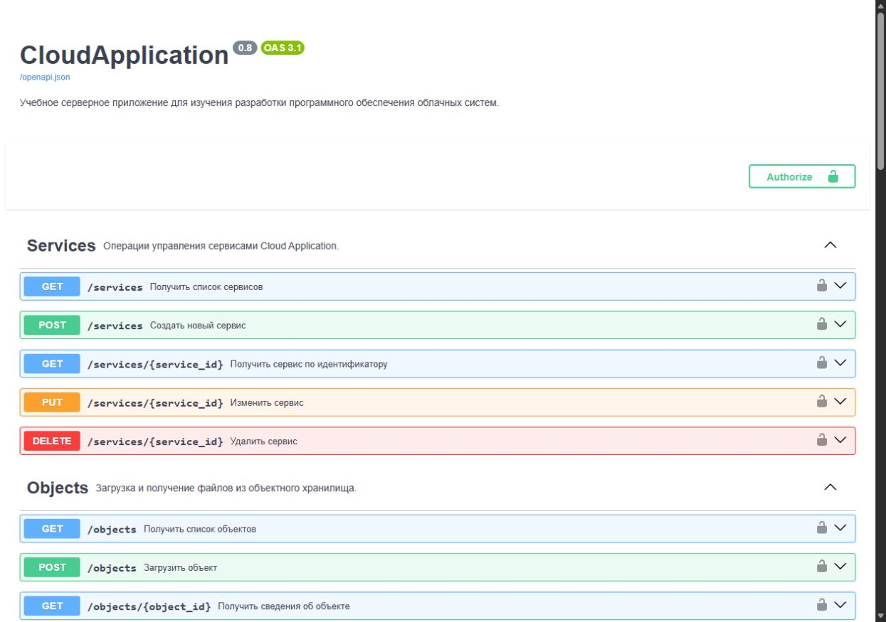
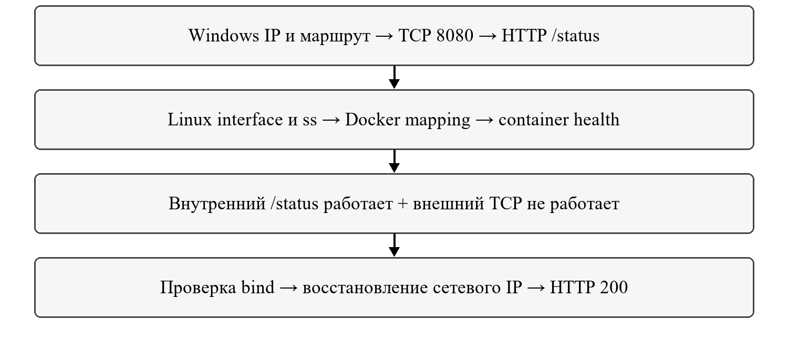

# Лабораторная работа 39

## Настройка сетевого доступа к приложению

Автор: Дьяченко Артем
Дата выполнения: 21 ноября 2026 года

Дисциплина: Управление работами и разработка программного обеспечения облачных систем. Результат обучения: РО 3.2 Эксплуатировать облачные системы.

## Цель работы

Настроить доступ из Windows к Compose-системе Cloud Application по сетевому IP Linux, проверить сетевой путь, закрытость инфраструктурных портов и восстановление после ошибки bind-address.

## Лабораторная топология и сетевой паспорт

Работа выполнена локально в отдельном дистрибутиве CloudLabs на WSL 2. Вместо двух адаптеров VirtualBox NAT и Host-only используется виртуальная NAT-сеть Hyper-V WSL: Windows и Linux связаны через vEthernet и eth0. Один eth0 обслуживает связь с Windows и исходящий NAT. Отдельного VirtualBox Host-only интерфейса нет. Проверяемый адрес не относится к физической LAN.

| Параметр | Фактическое значение |
| --- | --- |
| Hostname и ОС | cloudlabs, Ubuntu 24.04.5 LTS |
| Виртуализация | WSL 2 / Hyper-V, NAT |
| Linux интерфейс | eth0 |
| Linux IPv4 | 172.30.86.85/20 |
| Маска | 255.255.240.0 |
| Windows адаптер | vEthernet (WSL (Hyper-V firewall)) |
| Windows IPv4 | 172.30.80.1 |
| Default route | via 172.30.80.1 dev eth0 |
| Лабораторная подсеть | 172.30.80.0/20 |
| Compose project | cloudapp-lr38 |
| Docker и Compose | 29.1.3 / 2.40.3+ds1-0ubuntu1~24.04.1 |
| Публикация app | 172.30.86.85:8080 → 8000 |
| Внутренние имена | db:5432; notification:9000 |
| Firewall | Правила Windows и Linux не изменялись |



Рисунок 1 Сетевой путь Windows к приложению

```text
lo               UNKNOWN        127.0.0.1/8 10.255.255.254/32 ::1/128
eth0             UP             172.30.86.85/20 fe80::215:5dff:fe84:aa8a/64
docker0          UP             172.17.0.1/16 fe80::84d2:eaff:fee6:4cf/64
br-504e02953436  UP             172.18.0.1/16 fe80::583f:66ff:fe44:6473/64
veth52cd5dc@if2  UP             fe80::b4be:f9ff:fe19:ccde/64
veth1e8ccd2@if2  UP             fe80::7811:d0ff:fe1f:44b0/64
veth3fcd3b3@if2  UP             fe80::84d2:ddff:fe2b:8374/64
veth5f3a271@if2  UP             fe80::30e9:6ff:fe92:fab6/64
default via 172.30.80.1 dev eth0 proto kernel
172.17.0.0/16 dev docker0 proto kernel scope link src 172.17.0.1
172.18.0.0/16 dev br-504e02953436 proto kernel scope link src 172.18.0.1
172.30.80.0/20 dev eth0 proto kernel scope link src 172.30.86.85
```

## Подготовка многокомпонентной системы

Для зависимости от ЛР 38 создан отдельный Compose deployment в /opt/cloud-application/deploy. Использованы app, PostgreSQL 18, Notification Service, одноразовые миграции и постоянные volumes. Все сервисы используют отдельную внутреннюю сеть. У app, db и notification настроены healthcheck и unless-stopped; migrate завершился с кодом 0.

При первом переносе только compose.yaml не был перенесён относительный каталог docker/postgres с базовой SQL-схемой. Миграция сообщила relation "services" does not exist. Каталог перенесён, в новой учебной БД однократно применена базовая схема, затем успешно повторены миграции. В deploy/lr39-install.sh включено копирование SQL перед первым запуском. Исправленная процедура дополнительно проверена на отдельном чистом Compose-проекте с новым volume.

```text
Alembic head: 008_password_hash
app: running / healthy
db: running / healthy
notification: running / healthy
migrate: Exited (0)
```

## Исходная loopback публикация

```text
docker compose port app 8000
127.0.0.1:8080
ss -ltn
LISTEN 127.0.0.1:8080
curl http://127.0.0.1:8080/status → HTTP 200
```

```text
$labIp = "172.30.86.85"
Test-NetConnection -ComputerName $labIp -Port 8080
RemotePort: 8080
SourceAddress: 172.30.80.1
TcpTestSucceeded: False
```

Приложение отвечает внутри Linux, но соединение Windows с сетевым IP Linux не устанавливается. Проверялся именно IP Linux, поскольку механизм localhost forwarding WSL может отдельно пересылать обращения к localhost Windows.

## Изменение Compose и пересоздание приложения

```text
ports:
  - "${APP_PUBLISH_IP:-127.0.0.1}:${APP_PUBLISH_PORT:-8080}:8000"
```

Резервная версия Compose соответствует зафиксированной Git-ревизии. В deployment используется следующая Compose .env без секретов:

```text
COMPOSE_PROJECT_NAME=cloudapp-lr38
CLOUD_APP_IMAGE=cloud-application:lr37-stable
CLOUD_ENV_FILE=/etc/cloud-application/cloud-application.env
CLOUD_SECRETS_DIR=/etc/cloud-application-container/secrets
APP_PUBLISH_IP=172.30.86.85
APP_PUBLISH_PORT=8080
```

APP_PUBLISH_IP подставляется Compose в ports. CLOUD_ENV_FILE указывает на другой файл, который env_file сервиса передаёт в окружение приложения. Эти механизмы выполняют разные задачи. Пароли остаются в подключённых файлах secrets.

```text
docker compose config --quiet
# Код завершения 0
docker compose up -d --no-deps --force-recreate app
docker compose port app 8000
172.30.86.85:8080
State  Recv-Q Send-Q Local Address:Port Peer Address:PortProcess
LISTEN 0      4096    172.30.86.85:8080      0.0.0.0:*    users:(("docker-proxy",pid=575,fd=7))
```

Пересоздан только app. PostgreSQL, Notification Service и volumes не удалялись. Простой restart не применяет новый port mapping.

## Проверки из Linux и Windows

```text
curl http://172.30.86.85:8080/status → HTTP 200
Test-NetConnection -ComputerName 172.30.86.85 -Port 8080
SourceAddress: 172.30.80.1
TcpTestSucceeded: True
Invoke-WebRequest http://172.30.86.85:8080/status → HTTP 200
{"status": "ok", "service": "CloudApplication", "environment": "production", "host": "0.0.0.0", "port": 8000, "api_prefix": "/api"}
/docs → HTTP 200
```



Рисунок 2 Swagger UI в Microsoft Edge Windows по сетевому IP Linux

| Направление или сервис | Адрес | Результат |
| --- | --- | --- |
| Windows → app TCP | 172.30.86.85:8080 | Доступен |
| Windows → /status | 172.30.86.85:8080 | HTTP 200 |
| Windows → /docs | 172.30.86.85:8080 | HTTP 200, интерфейс открыт |
| Windows → PostgreSQL | 172.30.86.85:5432 | TCP недоступен |
| Windows → Notification | 172.30.86.85:9000 | TCP недоступен |
| app → db | db → 172.18.0.4 | DNS и БД доступны |
| app → notification | notification → 172.18.0.2 | DNS и /status доступны |

У db и notification отсутствует секция ports. Записи 5432/tcp или 8000/tcp в docker ps описывают метаданные image и не означают публикацию на хост. БД использует внутренний 5432, Notification Service фактически слушает внутренний 9000.

```text
DNS db: 172.18.0.4
DNS notification: 172.18.0.2
Notification /status: {"service": "notification", "status": "running"}
```

## Последовательная диагностика и контролируемый отказ



Рисунок 3 Последовательная диагностика сетевого пути

| Уровень | Инструмент | Полученный результат |
| --- | --- | --- |
| Клиент → Linux | IP Windows и Test-NetConnection | 172.30.80.1 → 172.30.86.85 |
| Клиент → TCP 8080 | Test-NetConnection | False на loopback, True на eth0 |
| Linux interface | ip -br addr | eth0 UP, 172.30.86.85/20 |
| Linux route | ip route | Подсеть /20 и default через host |
| Host socket | ss -ltn | Прослушивается выбранный bind |
| Docker mapping | docker compose port app 8000 | 172.30.86.85:8080 |
| Container state | docker compose ps | app/db/notification healthy |
| Application logs | docker compose logs app | Успешный startup, HTTP-запросы |
| Internal health | urllib внутри app | /status HTTP 200 |

APP_PUBLISH_IP временно возвращён в 127.0.0.1, пересоздан только app. Локальный /status Linux и запрос внутри контейнера продолжили работать, а Test-NetConnection Windows на сетевой IP вернул False. Первопричина — host bind на loopback, а не отказ приложения, базы данных или Notification Service. После возврата 172.30.86.85 и пересоздания app внешний TCP снова стал доступен, HTTP /status вернул 200.

| Этап | Внутренний HTTP | TCP Windows → IP Linux |
| --- | --- | --- |
| Исходный loopback | 200 | False |
| Сетевой bind | 200 | True |
| Контролируемый loopback | 200 | False |
| Восстановленный сетевой bind | 200 | True |

## Самостоятельная проверка и итоговое состояние

Дополнительно выполнено 18 проверок HTTP: регистрация и вход, отказ без авторизации, запрет записи viewer, операции сервисов и файлов под operator, межсервисная отправка уведомления, сохранность БД, файла и сессии после restart app, выход и отказ закрытой сессии. Созданные тестовые данные удалены. Пароли и session token в журнале не обнаружены.

После перезапуска дистрибутива CloudLabs systemd-служба ЛР 36 и контейнеры автоматически восстановились. app, db и notification находятся в healthy; migrate завершён успешно. Итоговый /status по 172.30.86.85:8080 доступен. Сетевой паспорт приведён в начале отчёта. WSL IP может измениться после полного перезапуска виртуальной среды; в таком случае APP_PUBLISH_IP обновляется по фактическому адресу и пересоздаётся только app.

## Ответы на контрольные вопросы

1. Что называется сетевым интерфейсом?
Точка подключения ОС к сети, физическая или виртуальная.

2. Что представляет собой IPv4-адрес?
32-битный адрес интерфейса в IPv4-сети.

3. Для чего используется маска сети?
Она определяет сетевую часть адреса и принадлежность адресов одной подсети.

4. Что показывает ip -br addr?
Краткий список интерфейсов, их состояния и адресов.

5. Что показывает ip route?
Маршруты, интерфейсы и шлюзы для передачи IP-пакетов.

6. Что называется default route?
Маршрут, используемый, когда для назначения нет более точного совпадения.

7. Для чего в лабораторной VM используется NAT?
Для исходящего доступа VM к Интернету через трансляцию адресов.

8. Для чего используется Host-only Adapter?
Для изолированного соединения Windows-хоста и виртуальных машин.

9. Чем Host-only отличается от Bridged networking?
Host-only ограничен хостом и VM; Bridged включает VM в физическую сеть.

10. Почему в ЛР №39 Host-only безопаснее Bridged?
Учебный HTTP-порт не становится доступным другим устройствам физической сети.

11. Что представляет собой loopback?
Внутренний интерфейс ОС для связи процессов на той же машине.

12. Какой IPv4-адрес обычно используется для loopback?
Обычно 127.0.0.1 из диапазона 127.0.0.0/8.

13. Почему 127.0.0.1:8080 недоступен с Windows-host?
Такой сокет принимает обращения только к loopback Linux-среды, а не к её сетевому IP. WSL может отдельно пересылать localhost Windows; проверялся именно сетевой IP.

14. Что означает Docker mapping 127.0.0.1:8080:8000?
Порт 8080 на loopback Docker-хоста перенаправляется на 8000 контейнера.

15. Что означает mapping VM_IP:8080:8000?
Порт 8080 на конкретном сетевом IPv4 Linux-хоста перенаправляется на 8000 контейнера.

16. Что представляет собой container port?
Порт процесса внутри сетевого пространства контейнера.

17. Что представляет собой host port?
Порт Linux-хоста, опубликованный Docker для входящих обращений.

18. Почему приложение внутри контейнера слушает 0.0.0.0:8000?
Чтобы принимать трафик, приходящий на сетевой интерфейс контейнера.

19. Почему host bind может быть конкретным IP?
Это ограничивает входящие обращения выбранным интерфейсом хоста.

20. Что произойдёт, если host IP в Docker mapping не соответствует нужному интерфейсу?
Нужный путь останется недоступным; при отсутствии такого адреса на хосте создание публикации может завершиться ошибкой.

21. Для чего используется docker compose port?
Для просмотра фактически опубликованного адреса и порта сервиса.

22. Что показывает ss -ltn?
Локальные TCP-сокеты в состоянии прослушивания.

23. Для чего используется Test-NetConnection?
Для проверки возможности установить TCP-соединение с заданным адресом и портом.

24. Чем проверка TCP отличается от HTTP-проверки?
TCP проверяет соединение, HTTP — ответ приложения, код и содержимое.

25. Почему успешный ping не гарантирует доступность HTTP?
ICMP не проверяет ни TCP-порт, ни HTTP-сервис.

26. Почему неуспешный ping не всегда доказывает недоступность TCP?
ICMP может фильтроваться отдельно от TCP.

27. Что означает TcpTestSucceeded=True?
TCP-соединение с указанным адресом и портом установлено.

28. Почему PostgreSQL не публикуется на host?
БД нужна только внутренним компонентам; публикация увеличивает поверхность доступа.

29. Почему Notification Service не публикуется на host?
Она используется приложением по внутренней сети и не нужна внешнему клиенту.

30. Каким образом app обращается к PostgreSQL?
По имени db и внутреннему порту 5432 в Compose-сети.

31. Каким образом app обращается к Notification Service?
По URL http://notification:9000 во внутренней сети.

32. Почему внутренние DNS-имена Compose не используются клиентским Windows-компьютером?
Эти имена разрешает встроенный Docker DNS только в соответствующей сети контейнеров.

33. Для чего используется .env рядом с compose.yaml?
Для подстановки переменных в Compose-модель, например адреса публикации.

34. Чем Compose .env отличается от env_file сервиса?
Compose .env интерполирует YAML; env_file передаёт переменные в окружение конкретного сервиса.

35. Почему после изменения port mapping контейнер необходимо пересоздать?
Публикация задаётся при создании контейнера и не меняется при простом перезапуске процесса.

36. Достаточно ли команды docker compose restart для применения нового mapping?
Нет, нужен up -d --no-deps --force-recreate app.

37. Почему диагностика начинается с клиента?
Чтобы последовательно отделить ошибку адреса и маршрута от отказа сокета, контейнера и приложения.

38. Что проверяется командой ip -br addr?
Наличие нужного IP на работающем Linux-интерфейсе.

39. Что проверяется командой ss?
Наличие слушающего сокета и его bind-address.

40. Что проверяется командой docker compose port?
Соответствие публикации нужному сетевому IP и порту.

41. Что позволяет доказать внутренний /status контейнера?
Что приложение внутри контейнера работает независимо от внешнего сетевого пути.

42. Как контролируемый loopback-эксперимент помогает локализовать проблему?
При рабочем внутреннем HTTP и недоступном внешнем TCP причина локализуется на уровне публикации, а не бизнес-логики.

## Вывод

Сетевой доступ к Compose-приложению настроен и проверен с Windows. Экспериментально подтверждено различие loopback и сетевой публикации, сохранена закрытость PostgreSQL и Notification Service. Контролируемый отказ локализован на уровне bind-address и устранён. Система оставлена работающей для последующих сетевых лабораторных работ; использована топология WSL 2 вместо VirtualBox.
