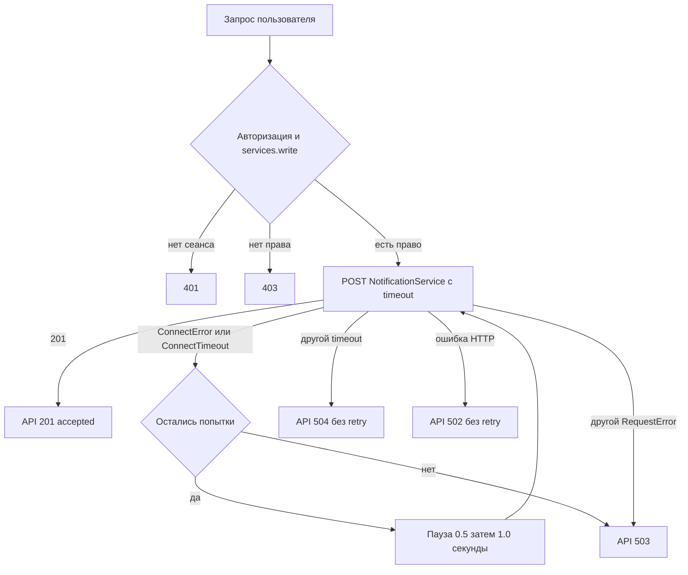
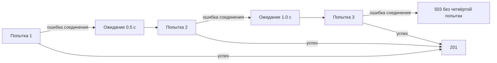

# Лабораторная работа № 30

## Обработка ошибок сетевого взаимодействия

Дата проверки: 4 ноября 2026 года. Проект: CloudApplication. Цель: сделать вызов NotificationService устойчивым к ошибкам соединения, ожидания и HTTP без нарушения авторизации.

Работа выполнена на main 15bcca2, включающем ЛР29 (db820b5, 07ff0a4), в ветке feature/network-error-handling. Изучены удалённые ветки прежних работ. В ЛР29 исходящий POST не проверял HTTP-код; интеграционный маршрут возвращал 200. Теперь он явно возвращает 201 согласно таблицам и критериям задания (пример декоратора в задании этот параметр пропускает).

## Типы событий и публичные ответы

| Событие | Исключение HTTPX | Исключение интеграции | Retry | Код API |
|---|---|---|---|---|
| Уведомление принято | нет | нет | нет | 201 |
| Не установлено соединение | ConnectError / ConnectTimeout | NotificationServiceUnavailable | до 3 попыток | 503 |
| Долгое ожидание после соединения | ReadTimeout / WriteTimeout / PoolTimeout | NotificationServiceTimeout | нет | 504 |
| Ошибочный HTTP-статус | HTTPStatusError | NotificationServiceBadResponse | нет | 502 |
| Другая транспортная ошибка | RequestError | NotificationServiceUnavailable | нет | 503 |

ConnectTimeout обрабатывается раньше общего TimeoutException, поэтому исчерпание попыток соединения даёт 503. Внутренний текст ответа не раскрывается пользователю.

## Схема межсервисного запроса



## Конфигурация

В Settings добавлены notification_timeout_seconds=2.0, notification_max_attempts=3, notification_retry_delay_seconds=0.5. Валидация запрещает неположительный timeout, число попыток меньше 1 и отрицательную задержку. Эти параметры не являются секретами.

В .env.example:

```dotenv
NOTIFICATION_SERVICE_URL=http://127.0.0.1:9000
NOTIFICATION_TIMEOUT_SECONDS=2.0
NOTIFICATION_MAX_ATTEMPTS=3
NOTIFICATION_RETRY_DELAY_SECONDS=0.5
```

Compose использует http://notification:9000 и подстановки ${NOTIFICATION_TIMEOUT_SECONDS:-2.0}, ${NOTIFICATION_MAX_ATTEMPTS:-3}, ${NOTIFICATION_RETRY_DELAY_SECONDS:-0.5}. Это позволяет временно менять настройки переменными окружения и пересоздавать только app. Секреты созданы локально и исключены из Git.

## Исключения и полный интеграционный клиент

NotificationServiceError — базовое исключение; Unavailable — недоступность; Timeout — ожидание; BadResponse — ошибочный HTTP-ответ с сохранением status_code. Router зависит от этих классов, а не от HTTPX.

```python
import asyncio

import httpx

from app.config import settings


class NotificationServiceError(Exception):
    """Base error exposed by the notification integration."""


class NotificationServiceUnavailable(NotificationServiceError):
    pass


class NotificationServiceTimeout(NotificationServiceError):
    pass


class NotificationServiceBadResponse(NotificationServiceError):
    def __init__(self, status_code: int):
        self.status_code = status_code
        super().__init__(f"Notification service returned HTTP {status_code}")


async def send_notification(recipient: str, message: str) -> dict:
    url = f"{settings.notification_service_url.rstrip('/')}/notifications"
    payload = {"recipient": recipient, "message": message}
    timeout = httpx.Timeout(settings.notification_timeout_seconds)
    max_attempts = settings.notification_max_attempts

    for attempt in range(1, max_attempts + 1):
        try:
            async with httpx.AsyncClient(timeout=timeout) as client:
                response = await client.post(url, json=payload)
                response.raise_for_status()
                return response.json()
        except (httpx.ConnectError, httpx.ConnectTimeout) as exc:
            if attempt == max_attempts:
                raise NotificationServiceUnavailable() from exc
            delay = settings.notification_retry_delay_seconds * (2 ** (attempt - 1))
            await asyncio.sleep(delay)
        except httpx.TimeoutException as exc:
            # A POST may already have been processed. Do not resend it.
            raise NotificationServiceTimeout() from exc
        except httpx.HTTPStatusError as exc:
            raise NotificationServiceBadResponse(exc.response.status_code) from exc
        except httpx.RequestError as exc:
            raise NotificationServiceUnavailable() from exc

    raise NotificationServiceUnavailable()


async def get_notification(notification_id: int) -> dict:
    url = f"{settings.notification_service_url.rstrip('/')}/notifications/{notification_id}"
    async with httpx.AsyncClient(timeout=httpx.Timeout(settings.notification_timeout_seconds)) as client:
        response = await client.get(url)
        response.raise_for_status()
    return response.json()
```

Timeout HTTPX ограничивает отдельные фазы сетевого ожидания, а не является общим жёстким дедлайном всей операции. При трёх ConnectTimeout по 2 секунды суммарное ожидание может приблизиться к 7,5 секунды плюс накладные расходы.

## Политика повторов

Повторяются только ConnectError и ConnectTimeout. Всего выполняются максимум три попытки, включая первую. Задержка после неудачной попытки k равна 0.5 × 2^(k−1); после последней попытки задержки нет. Ответы HTTP и тайм-ауты после соединения повторять нельзя: POST мог уже создать уведомление.



## Полный router интеграции

```python
from fastapi import APIRouter, Depends, HTTPException

from app.data.models import User
from app.integrations.notification_client import (
    NotificationServiceBadResponse,
    NotificationServiceTimeout,
    NotificationServiceUnavailable,
    send_notification,
)
from app.schemas.integration import NotificationSendRequest, NotificationSendResponse
from app.security.authorization import require_permission

router = APIRouter(prefix="/integration", tags=["Integration"])


@router.post(
    "/notifications", response_model=NotificationSendResponse, status_code=201,
    summary="Передать уведомление внутреннему сервису",
    responses={502: {"description": "Invalid upstream response"},
               503: {"description": "Upstream unavailable"},
               504: {"description": "Upstream timeout"}},
)
async def forward_notification(
    notification: NotificationSendRequest,
    current_user: User = Depends(require_permission("services.write")),
):
    try:
        return await send_notification(notification.recipient, notification.message)
    except NotificationServiceTimeout as exc:
        raise HTTPException(status_code=504, detail="Notification service response timeout") from exc
    except NotificationServiceUnavailable as exc:
        raise HTTPException(status_code=503, detail="Notification service is unavailable") from exc
    except NotificationServiceBadResponse as exc:
        raise HTTPException(status_code=502, detail="Notification service returned an invalid response") from exc
```

Проверка require_permission("services.write") сохранена. Тесты подтверждают, что пользователь без права получает 403 до вызова интеграции.

## Сборка и практическая проверка

Docker Desktop 4.98.0, Engine 29.9.2, Linux containers. Команда `docker build -t cloud-application:0.3 .` завершилась успешно. Образ: sha256:6852b2f8e26049c7229f927b7bcfbf348b86dbefe959f86c89517d7e37cf6f4e. Все три сервиса app, migrate, notification переведены на 0.3; OCI label Dockerfile также 0.3.

Стенд запущен отдельным Compose-проектом lr30. PostgreSQL healthy; migrate завершился с кодом 0; app и notification работают. Запросы выполнялись с реальным сеансом пользователя роли operator. Проверка воспроизводится скриптом scripts/verify_network_errors.ps1 на новом стенде. Скрипт создаёт учебного пользователя с уникальным именем при каждом запуске. Нужны PowerShell 7, Docker и свободный порт 8080.

Фактические ответы сохранены в evidence/lr30_results.json:

| Сценарий | Событие | Retry | Код | Время с | Результат |
|---|---|---|---|---|---|
| A работает | успешный ответ | нет | 201 | 0.069 | accepted, id 1 |
| B stop | ошибка соединения | да | 503 | 7.551 | Notification service is unavailable |
| D start | успешный ответ | нет | 201 | 0.026 | accepted, id 1 |
| C pause | timeout после соединения | нет | 504 | 2.025 | Notification service response timeout |
| D unpause | успешный ответ | нет | 201 | 0.022 | accepted, id 3 |
| timeout 1.0 | timeout после соединения | нет | 504 | 1.112 | response timeout |
| 2 попытки и 0.25 | ошибка соединения | да | 503 | 4.420 | is unavailable |
| Итоговое восстановление | успешный ответ | нет | 201 | 0.097 | accepted, id 1 |

Конкретный класс ошибки остановленного контейнера зависит от DNS и сети Docker; stop не гарантирует мгновенный Connection refused. Из HTTP-ответа нельзя установить точный подкласс исключения. Число попыток и обе задержки отдельно подтверждены автоматическими тестами с контролируемым транспортом.

После unpause id увеличился до 3: ожидавший запрос мог выполниться после того, как клиент уже получил 504. Это практическая причина не повторять такой POST. Хранилище NotificationService находится в памяти: после stop/start id начинается заново.

Первый успешный ответ:

```json
{"recipient":"stable@cloud.local","message":"Network error handling enabled","id":1,"status":"accepted"}
```

Изменение timeout сократило ожидание примерно на 0.913 с. Изменение retry сократило время отказа примерно на 3.131 с; суммарная пауза уменьшилась с 1.5 до 0.25 с, также была исключена одна попытка соединения. Все временные настройки удалены, внутри работающего app подтверждены значения 2.0 / 3 / 0.5.

## Диагностический endpoint и HTTP ошибки

```python
@app.get("/test/error/{status_code}", summary="Сформировать тестовую ошибку")
def test_error(status_code: int):
    if not 400 <= status_code <= 599:
        raise HTTPException(status_code=422, detail="Use an HTTP error status from 400 to 599")
    raise HTTPException(status_code=status_code, detail="Test service error")
```

Диагностический endpoint размещён во внутреннем NotificationService, порт наружу не опубликован. Дополнительно ограничены допустимые коды, чтобы некорректные 1xx/2xx не создавали недействительные ответы.

Из контейнера app выполнены реальные GET http://notification:9000/test/error/503 и /400. Оба вернули соответствующие коды и {"detail":"Test service error"}; вызов raise_for_status() в обоих случаях создал HTTPStatusError. Результат в evidence/lr30_http_errors.json. Преобразование 400/503 в NotificationServiceBadResponse без повторов и публичный 502 проверены автоматическими тестами; стандартный POST /notifications диагностический endpoint не вызывает.

## Автоматические проверки

`docker run --rm -e LAB_DB_PASSWORD=test-only -e AUTH_SECRET=test-only --mount "type=bind,source=<repository>,target=/workspace" -w /workspace cloud-application:0.3 python -m pytest -q -p no:cacheprovider`

Результат: 34 passed, 2 warnings, 6.79 s. Предупреждения относятся к устаревающим интерфейсам Starlette TestClient и AnyIO в существующих зависимостях. Проверены успешный контракт, авторизация, 3 попытки, задержки 0.5/1.0, восстановление на третьей попытке, отсутствие retry для ReadTimeout, WriteTimeout, PoolTimeout, ReadError и HTTP 400/503, а также публичные ответы 502/503/504. Выполнена проверка git diff --check.

## Безопасность повторных POST

ConnectError разумно повторять, поскольку соединение не установлено и обычный запрос не дошёл до обработчика. Это практическая политика, а не универсальное доказательство отсутствия побочных эффектов для любой сети или прокси. ReadTimeout возникает после соединения: сервер мог создать объект, а ответ потеряться. Повтор тогда создаст дубликат. Ограничение числа попыток ограничивает задержку и нагрузку; увеличивающаяся пауза даёт сервису время восстановиться. При большом числе клиентов полезен jitter, но он не входит в эту работу.

Для безопасного повтора обработанного POST нужна идемпотентность: уникальный request_id создаётся один раз на пользовательскую операцию и остаётся тем же во всех попытках; сервис атомарно хранит соответствие request_id → результат и возвращает прежний результат при повторе. Для нескольких процессов и рестартов необходимо общее устойчивое хранилище и уникальное ограничение, а не только словарь в памяти. Тогда можно рассматривать retry при ReadTimeout и отдельных временных HTTP 5xx с ограничениями. Дополнительная реализация идемпотентности не входит в обязательную часть и не добавлена.

## Ответы на контрольные вопросы

1. Удалённый HTTP-вызов зависит от сети, DNS, удалённого процесса и нагрузки; локальный вызов не пересекает эти границы.
2. Timeout — ограничение допустимого ожидания определённого этапа операции.
3. Ограничение ожидания освобождает ресурсы и даёт клиенту предсказуемую ошибку.
4. HTTPX различает connect, read, write и pool timeout.
5. TimeoutException — базовый класс исключений тайм-аутов HTTPX.
6. ConnectError означает ошибку установления соединения.
7. HTTPStatusError означает неприемлемый HTTP-статус, обнаруженный raise_for_status().
8. raise_for_status() проверяет код ответа и создаёт исключение для неуспешного статуса; сам по себе он запрос не повторяет.
9. Retry — повторная попытка операции после ошибки.
10. Бесконечные повторы удерживают ресурсы, увеличивают задержку и нагрузку.
11. Exponential backoff — увеличение задержки по экспоненциальной формуле.
12. При базе 0.5 секунды используются паузы 0.5 и 1.0 секунды.
13. Используются три попытки всего, то есть максимум два повтора.
14. ConnectError повторяется, поскольку ошибка относится к установлению соединения.
15. ReadTimeout не повторяется, поскольку POST уже мог быть обработан.
16. POST может менять состояние; чтение обычно не создаёт новые объекты и потому безопаснее для повторов.
17. Дублирование операции — повторное выполнение одного намерения пользователя с дополнительным побочным эффектом.
18. Идемпотентность позволяет повторить запрос с тем же ключом и получить прежний результат.
19. Собственные исключения задают устойчивую границу между интеграцией и остальным приложением.
20. Router не должен зависеть от деталей конкретной HTTP-библиотеки; ему нужны предметные состояния интеграции.
21. 503 возвращается после исчерпания ошибок соединения либо другой ошибки транспорта без retry.
22. 504 возвращается при тайм-ауте, не относящемся к повторяемому установлению соединения.
23. 502 возвращается при ошибочном HTTP-ответе зависимого сервиса.
24. Внутренний ответ может раскрыть детали реализации и не соответствовать публичному контракту.
25. stop завершает процесс, pause замораживает его с сохранением состояния процесса.
26. Paused-контейнер восстанавливается docker compose unpause notification.
27. После восстановления новый запрос создаёт новое соединение; постоянного блокирующего состояния клиент не хранит.
28. Параметры определены в Settings, .env.example и окружении Compose; локальные значения могут поступать из .env.
29. Timeout и retry не являются секретами.
30. URL находится в конфигурации, поскольку локальная и контейнерная адресация различаются.
31. Ограничение повторов предотвращает бесконечное ожидание и неконтролируемую нагрузку.
32. Увеличение паузы снижает частоту повторных обращений и даёт сервису время восстановиться.
33. Одновременные повторы многих клиентов создают дополнительную нагрузку именно во время сбоя.
34. /test/error/{status_code} воспроизводит ошибочный HTTP-ответ для исследования.
35. Нужно получить ответ с кодом 400 или 503 и вызвать response.raise_for_status(); результат — HTTPStatusError.
36. Полноценное журналирование выделено в следующую ЛР31; здесь реализована обработка ошибок, без собственной системы логов.
37. Нужны request_id, атомарная дедупликация и сохранение результата для повторного запроса.

## Git и вывод

Ветка feature/network-error-handling создана от main без изменения прежних веток. Сообщение коммита: Handle service communication errors. Отчёт и фактические результаты включены в тот же коммит; точный hash доступен через git log -1 и на странице ветки GitHub.

Реализованы явный timeout, ограниченный retry только при установлении соединения и контролируемые ответы API. Практически проверены успех, stop, pause, восстановление и изменение конфигурации. Авторизация сохранена. Подтверждён риск выполнения POST после тайм-аута; для расширения retry нужна идемпотентность.
